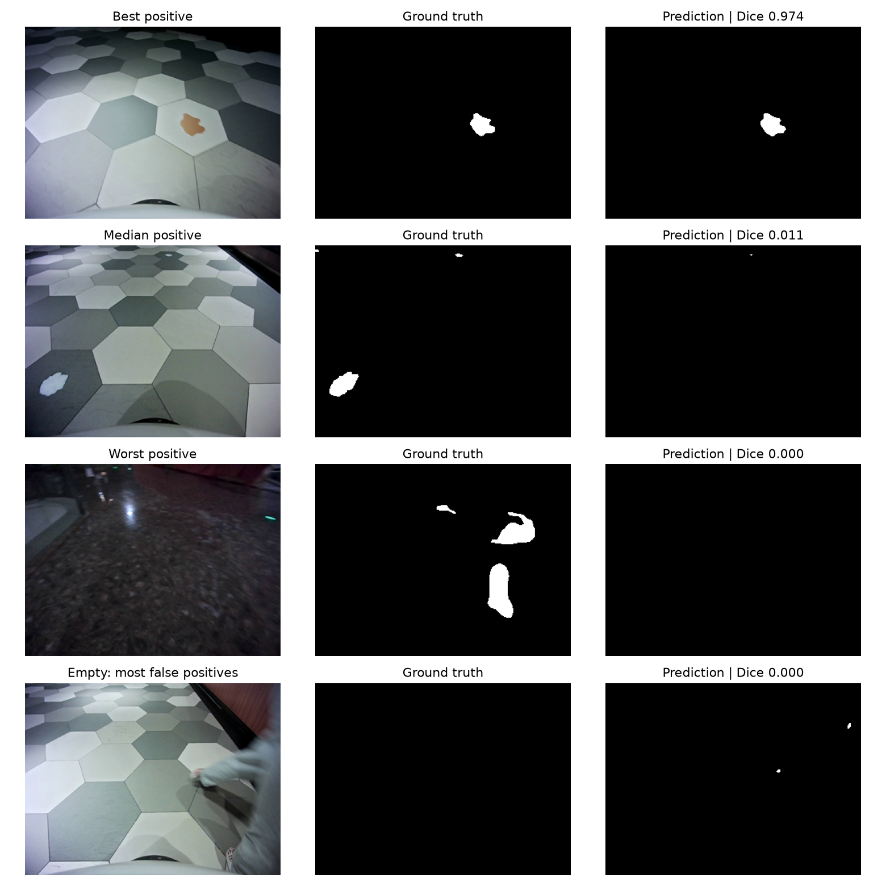

# U-Net baseline 实验记录：HD10K 液体污渍分割

记录整理日期：2026-10-18。实验日期：2026-10-14，时间均为北京时间。

本记录整理已经发生的训练和评估，不重新训练，不把后续改进实验计入 baseline。

## 目的与实现

建立 HD10K IROS2022 液体污渍二值分割的 U-Net 对照基线，保留训练过程、失败和实际效果，供后续方法比较。

实现基于 milesial/Pytorch-UNet，使用 RGB 输入、2 类输出和转置卷积上采样。现有代码位于 [baselines/unet](../../baselines/unet/README.md)，保留原 GPL-3.0 许可证。它是经过本地数据适配和稳定性修复的 baseline，不声称是未经修改的上游默认实现。

## 数据及划分

- 本地数据根目录：`C:/program1/HD10K_IROS2022/IROS2022_Dataset`。
- 使用 `train/liquid_dirts/images` 与 `train/liquid_dirts/liquid_dirts_masks`，按场景相对路径和同名文件配对，共 4000 对。
- 过滤 `._` 等隐藏元数据文件；兼容 1-bit、RGB、调色板掩码，将 RGB 任一通道非零的像素作为前景。全量检查未发现不可读图片、尺寸不匹配或非有限输入。
- seed=0 随机划分 3600 张训练、400 张验证。第 15 轮详细评估确认验证集有污渍和空掩码各 200 张。
- 原图 640×480，缩放 0.5 后输入 320×240；本 baseline 未加入训练数据增强。
- solid_dirts 提供检测框，不纳入本次像素级分割训练。未用独立 test 集报告性能。

随机视频帧划分可能在训练/验证间共享近邻帧与场景，验证结果不能代表跨场景泛化性能。

## 实际训练配置

| 项目 | 设置 |
| --- | --- |
| GPU | NVIDIA GeForce RTX 3070，8 GB |
| 模型初始化 seed | 42 |
| 轮数 / batch size | 30 / 1 |
| 精度 | FP32，AMP 关闭 |
| 优化器 | AdamW，初始学习率 1e-4，weight decay=1e-8 |
| 损失 | CrossEntropyLoss + 多类 Dice loss |
| 梯度裁剪 | 最大范数 1.0；非有限梯度立即报错 |
| 调度器 | ReduceLROnPlateau，max，patience=5，每轮更新 |
| 验证频率 | 每轮约 5 次，在 400 张验证集上计算 |
| 数据加载 workers | 0 |
| 检查点 | 每轮保存模型；另存最近完整训练状态 |

[run-config.json](../../baselines/unet/run-config.json) 保存配置；[environment-observed.txt](../../baselines/unet/environment-observed.txt) 是归档时环境快照，并非训练起点环境锁定文件。

## 失败与修复经过

首次 AMP/RMSprop 运行在第 1 轮约第 1336 步首次记录 NaN，程序未及时停止。该运行虽然完成 30 轮并生成检查点，但第 1、2、5、30 轮检查点均检测到非有限参数；最终有 100 个参数张量异常，不能作为可用模型结果。

随后检查全部 4000 对数据，未发现上述数据有效性问题。数值不稳定的具体单一根因未通过隔离实验确定；不能把原因简单归结为数据或某一个组件。

已实施的修复是关闭 AMP、改用 AdamW、损失相关计算使用 FP32，并检查预测、损失、梯度、验证输出和待保存参数。异常会触发停止，避免继续保存损坏模型。用空/非空掩码验证过正常训练、异常拦截和完整训练状态恢复。

2026-10-14 08:48 从新初始化权重开始修复后的 30 轮训练，没有加载旧 NaN 检查点。13:00 完成；最终模型导出通过全部 118 个状态张量的有限值检查和单张真实图像推理检查。

## 实测结果：保留不足，不混淆轮次

| 指标 | 第 15 轮详细评估 | 第 30 轮最终日志 |
| --- | ---: | ---: |
| 全验证集平均 Dice | 0.6121446 | 0.6783230 |
| 有污渍图片平均 Dice | 0.2542893 | 未单独统计 |
| 有污渍图片平均 IoU | 0.2061144 | 未单独统计 |
| 像素汇总 micro Dice | 0.3688187 | 未单独统计 |
| 前景像素 precision | 0.9858714 | 未单独统计 |
| 前景像素 recall | 0.2268403 | 未单独统计 |
| 空掩码图片出现任意误检 | 6/200（3%） | 未单独统计 |
| 平均训练 loss | 此处不另行推算 | 0.002572 |

第 15 轮详细数字来自当时已经完成的 400 张验证评估：[原始 JSON](../../baselines/unet/results/epoch15-validation.json)。第 30 轮 Dice 来自最终一次验证日志，不是独立测试集结果；未把第 15 轮的 precision/recall 冒充为最终模型指标。

第 15 轮预测偏保守，检出的前景多数正确，但约 77.3% 的前景像素未检出。有些明显污渍几乎完全漏检。验证集中一半为空掩码，正确预测空掩码会提高全体平均 Dice，因此不能仅凭整体 Dice 判断前景识别质量。第 30 轮整体 Dice 有提升，但缺少相同口径的前景详细统计，不能据此认定漏检已经解决。

## 产物与可追溯性

- [训练摘要](../../baselines/unet/results/training-summary.log)：从原日志提取，不含新增实验。
- [导出验证记录](../../baselines/unet/results/model-export.log) 与 [产物清单](../../baselines/unet/results/run-manifest.json)。
- 有效第 30 轮权重：`C:/program1/Pytorch-UNet-master/Pytorch-UNet-master/checkpoints_hd10k_fixed_20261014/checkpoint_epoch30.pth`。
- 导出权重：`C:/program1/Pytorch-UNet-master/Pytorch-UNet-master/MODEL_VALID.pth`，大小 124242215 字节。
- 导出时 SHA256：`a0ae3fed171c7adad1339e45fdc99eb5ea04320835a59c889e512872370b9969`。
- 原始数据、124 MB 权重和全部中间检查点不进 Git；当前清单提供本地位置，没有公开下载链接。
- 后续 `liquid_improved`、`liquid_final` 等阈值调整或微调实验与本 baseline 分开，不混用其结果。

## 结论与后续待办

本次完成了能够正常推理的 30 轮 U-Net baseline，并保留了失败运行、配置和结果证据。当前证据仍暴露较强漏检，不能作为成熟检测方案。

后续应先用相同口径补齐第 30 轮前景指标和可视化，再做按场景/序列隔离的独立评估。类别不平衡、损失权重、采样策略与阈值可作为之后独立对照实验；这些是待办，本次归档没有执行。
